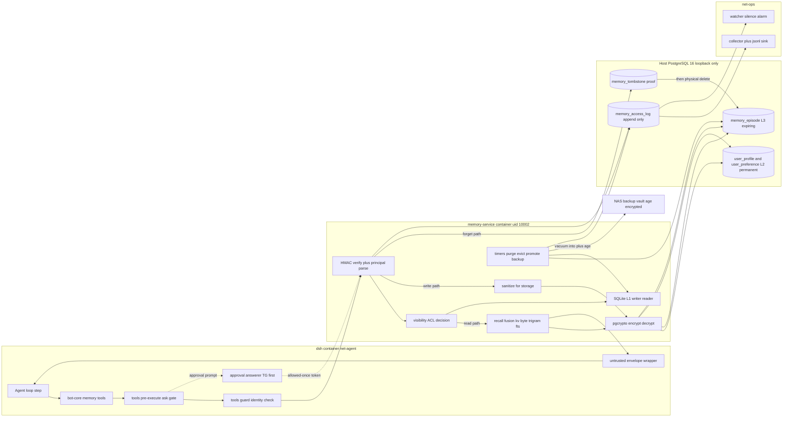
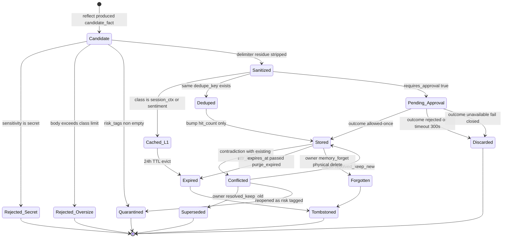
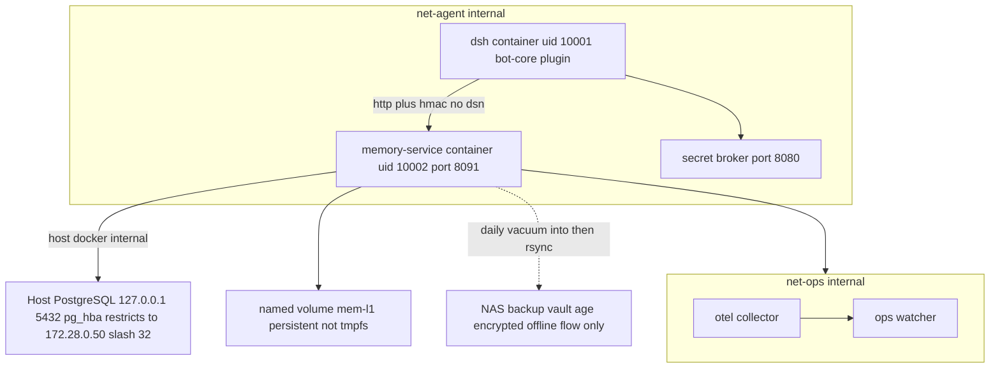

# t4 · 记忆系统 ER 图与数据流（Memory ERD）

> 配套：`t4-memory-architecture.md`（§3 表结构 / §4 分层机制 / §5 隐私 / §6 DSH 集成 / §7 检索 / §8 备份 / §9 连接）
> 权威 DDL：`sql/pg/001_schema.sql`（已在临时 PG 16.15 实例上执行验证，见 arch §14.1）
> 图例：`erDiagram` 的关系基数按**实际外键**绘制，非概念臆测。所有表名/列名与已执行 schema 一致。

---

## 1. 实体关系图（权威库 `dsh_companion` / schema `companion`）

```mermaid
erDiagram
    MEMORY_CLASS_POLICY {
        string class PK "enum memory_class 7 values"
        int layer "1 L1 cache 2 L2 profile 3 L3 episodic 4 L4 semantic"
        int ttl_days "NULL means permanent"
        bool requires_approval "true means tools pre-execute ask"
        bool encrypt_at_rest "true for pii_raw"
        int max_body_chars "200 to 8000"
        int recency_half_life_days "NULL means no decay"
        bool allow_auto_write "only session_ctx and sentiment"
    }

    SUBJECT {
        uuid subject_id PK
        string subject_key UK "channel kind id, never display name"
        string channel
        string external_id
        string peer_kind "dm group channel"
        string identity_trust "server_backed unbacked unknown"
        bool is_owner "CHECK requires server_backed"
        ts created_at
        ts last_seen_at
    }

    USER_PROFILE {
        uuid profile_id PK
        uuid subject_id FK
        string attr_key "call_me timezone allergy"
        string value_plain "nullable when encrypted"
        bytes value_enc "pgp symmetric ciphertext"
        string sensitivity "public internal pii secret never stored"
        float confidence
        int hit_count
        string dedupe_key "sha256 subject class normalized body"
        string source_ref "reference only, no raw text"
        int version "upsert chain, old rows superseded"
        uuid superseded_by FK
        string visibility
    }

    USER_PREFERENCE {
        uuid pref_id PK
        uuid subject_id FK
        string scope "global dm group"
        string scope_peer
        string peer_slot "generated coalesce scope_peer"
        string pref_key "food avoid notify quiet hours"
        string value_plain
        bytes value_enc
        string sensitivity
        bool is_veto "taboo wins ranking"
        string dedupe_key
        string visibility
    }

    MEMORY_EPISODE {
        uuid episode_id PK
        uuid subject_id FK
        string peer_key "ACL input"
        string class "commitment episode sentiment"
        string body_plain "nullable when encrypted"
        bytes body_enc
        string body_hash "sha256, tombstone linkage"
        string dedupe_key
        string sensitivity
        string visibility "group default peer"
        ts occurred_at
        ts expires_at "NULL means policy permanent"
        int hit_count
        float confidence
        array risk_tags "ingress RiskTag passthrough"
        string source_channel
        string approved_by "approval request id, opaque"
        uuid superseded_by FK
    }

    SESSION_CONTEXT {
        uuid ctx_id PK
        string peer_key
        uuid subject_id FK
        jsonb topic_stack
        string summary_hash "raw text lives in SQLite L1 only"
        jsonb candidate_promotions
        int token_estimate
        ts expires_at "created plus 24h"
        uuid promoted_to
    }

    MEMORY_FACT {
        uuid fact_id PK
        uuid subject_id FK
        string predicate "has_allergy prefers_tone"
        string object_slot "generated column for unique"
        string object_plain
        bytes object_enc
        array evidence_refs "episode ids"
        smallint support_count
        float confidence
    }

    MEMORY_EMBEDDING {
        uuid embedding_id PK
        string object_kind "episode profile preference fact"
        uuid object_ref
        string model "version must be pinned"
        smallint dim "64 to 4096"
        jsonb vec_jsonb "phase 1 placeholder"
    }

    MEMORY_ACCESS_LOG {
        bigint log_id PK "identity, partitioned by ts monthly"
        ts ts "partition key"
        string actor_kind "agent service owner_cli job"
        string actor_id
        string operation "read write search delete decrypt promote purge refuse"
        string object_ref "memory id or query sha256, never plaintext"
        string class
        string sensitivity
        bool approved
        string approval_id
        string result "allowed denied error unavailable"
        array risk_tags
        int rows_returned
        int bytes_out
    }

    MEMORY_TOMBSTONE {
        uuid tombstone_id PK
        string object_kind
        string object_hash "irreversible proof of deletion"
        string class
        string sensitivity
        string deleted_by
        string reason_code "user_forget ttl_expired poison_reject conflict_supersede"
        string approval_id
        bool backup_rotated
    }

    PROFILE_CONFLICT {
        uuid conflict_id PK
        uuid subject_id FK
        string attr_key
        string existing_kind
        uuid existing_ref
        string incoming_hash
        jsonb incoming_meta "no raw body"
        string reason "contradiction low_confidence risk_tagged promotion_candidate"
        string status "open resolved_keep_old resolved_keep_new expired rejected_poison"
        ts resolved_at
    }

    JOB_RUN {
        string job PK "purge_expired l1_evict promote_candidates backup_sqlite"
        ts started_at PK
        ts finished_at
        int rows_affected
        string status "running ok failed"
        string detail_hash "no stack text"
    }

    ARTIFACT_BASELINE {
        string path PK
        string sha256 "migration checksum, watcher compares"
        ts recorded_at
    }

    L1_SQLITE_CONTEXT {
        string peer_key PK "part of composite pk"
        string slot PK "topic_stack pending_question entity_alias last_intent"
        string value_json "plain text, cache not a privacy boundary"
        string sensitivity "CHECK allows only public internal"
        int hits
        ts expires_at "created plus 24h"
    }

    L1_SQLITE_PROMOTION {
        int cand_id PK
        string subject_key
        string attr_key
        string value_hash "sha256, proposal only"
        int observations "qualify when 2 or more"
        int session_count "or spans 2 sessions"
        bool proposed
    }

    L1_SQLITE_DEDUPE {
        string dedupe_key PK "sha256 subject class normalized body"
        string memory_kind
        string memory_ref "PG uuid as text"
        int hit_count
        ts last_seen_at "7 day window"
    }

    SUBJECT ||--o{ USER_PROFILE : "owns stable facts"
    SUBJECT ||--o{ USER_PREFERENCE : "holds preferences"
    SUBJECT ||--o{ MEMORY_EPISODE : "experienced"
    SUBJECT ||--o{ MEMORY_FACT : "asserted about"
    SUBJECT ||--o{ SESSION_CONTEXT : "contextualized in"
    SUBJECT ||--o{ PROFILE_CONFLICT : "may contradict"
    USER_PROFILE |o--o| USER_PROFILE : "supersedes via version chain"
    MEMORY_EPISODE |o--o| MEMORY_EPISODE : "supersedes"
    MEMORY_CLASS_POLICY ||--o{ MEMORY_EPISODE : "governs ttl and approval"
    MEMORY_CLASS_POLICY ||--o{ USER_PROFILE : "governs encryption"
    MEMORY_EPISODE ||--o{ MEMORY_EMBEDDING : "optionally vectorized"
    USER_PROFILE ||--o{ MEMORY_EMBEDDING : "optionally vectorized"
    MEMORY_FACT ||--o{ MEMORY_EMBEDDING : "optionally vectorized"
    MEMORY_EPISODE ||--o{ PROFILE_CONFLICT : "existing_ref target"
    SESSION_CONTEXT ||--o{ PROFILE_CONFLICT : "promotion source"
    MEMORY_EPISODE ||--o| MEMORY_TOMBSTONE : "proven deleted"
    USER_PROFILE ||--o| MEMORY_TOMBSTONE : "proven deleted"
    SESSION_CONTEXT ||--o{ MEMORY_ACCESS_LOG : "audited access"
    L1_SQLITE_CONTEXT ||--o{ L1_SQLITE_PROMOTION : "feeds candidates"
    L1_SQLITE_PROMOTION ||--o| PROFILE_CONFLICT : "promoted into queue"
    L1_SQLITE_DEDUPE }o--|| MEMORY_EPISODE : "dedupe mirror"
    JOB_RUN ||--o{ MEMORY_TOMBSTONE : "purge writes"
```

### 1.1 阅读要点

- **两条 `supersedes` 自环**是 upsert 的实现方式：旧行不删、只置 `superseded_by`，因此纠错轨迹可查（arch §4.4）。视图 `memory_readable` 过滤 `superseded_by IS NULL`，应用层永远只看到当前有效值。
- **`MEMORY_TOMBSTONE` 没有指向原行的外键**——原行已被物理删除，留外键会阻止删除。这是"物理删除 + 可证明"能同时成立的唯一做法（arch §5.4）。
- **`SESSION_CONTEXT.summary_hash` 而非正文**：L1 原文只在 SQLite；PG 侧只留可审计的元数据（arch §3.3）。
- **`MEMORY_ACCESS_LOG` 按月分区 + DEFAULT 分区兜底**：无映射月份不会丢行；`prune_access_log()` 按分区上界 DETACH，保留期下限 90 天硬编码在函数里（arch §5.7）。
- **`L1_*` 三张表属于另一个引擎**（SQLite），画在同一 ERD 是为了显示唯一的跨引擎边 `L1_SQLITE_PROMOTION → PROFILE_CONFLICT`；该边由作业单向写入，不一致时以 PG 为准重建 L1（arch §8.3）。

---

## 2. 数据流图（一次读 / 一次写 / 一次遗忘）

### 2.1 三条路径的关键差异

| 路径 | 审批 | 加密 | 落点 | 审计 operation | 失败姿态 |
|---|---|---|---|---|---|
| read/search | ❌（只读类放行） | 解密在服务侧内存 | 返回即包封套 | `read` / `search` / `decrypt` | PG 不可达 → 503，**不用陈旧缓存冒充** |
| write (L2/L3) | ✅ `ask` + allowed-once 令牌 | `sensitivity>=pii` 强制 | PG 权威 + L1 投影 | `write` | 消毒后为空 → 422，不落库 |
| write (L1) | ❌（`allow_auto_write=true`） | 明文（缓存非隐私边界） | 仅 SQLite | 不单独记（24h 蒸发） | 容量触顶 → 丢最旧 slot 重试 |
| forget | ✅ owner-only + 令牌 | — | 先 tombstone 后 DELETE | `delete` | 无令牌 → DB 层也拒绝（函数未授予 rw 角色） |

---

## 3. 记忆条目状态机

### 3.1 状态语义约束（实现时必须成立）

1. **`Quarantined` 不是 `Stored` 的子集**：被隔离的候选永不进入检索结果，只能由 owner 显式裁决释放——这是 arch §4.5「打标且不自动固化」的落点。
2. **`Discarded` 有两个来源但同一后果**：`rejected`（人拒了）与 `unavailable`（通道全挂）都必须让本轮**零持久副作用**；后者尤其重要，否则审批通道故障会静默变成"自动批准"。
3. **`Expired` 与 `Forgotten` 都通向 `Tombstoned`**，区别只在 `reason_code`（`ttl_expired` vs `user_forget`）——运维据此判断"是自然过期还是有人要求删除"。
4. **`Cached_L1 → Expired` 不留 tombstone**：L1 是可丢弃缓存，为它建删除证明会把审计表刷满噪声（arch §8.5 的 access_log 体量估算据此才成立）。

---

## 4. 与 t3 拓扑的对接位置

> 图中**没有任何从 `dsh` 容器指向 NAS 目录或宿主 PG 的边**——这正是 U2/C-08 与 D-1 在记忆子系统里的形状化表达：agent 既拿不到 DSN，也碰不到备份盘。
> 唯一新增容器是 `MEMC`；网络复用既有 `net-agent`/`net-ops`，**不新增第五张网**（C-24 前提不变）。
