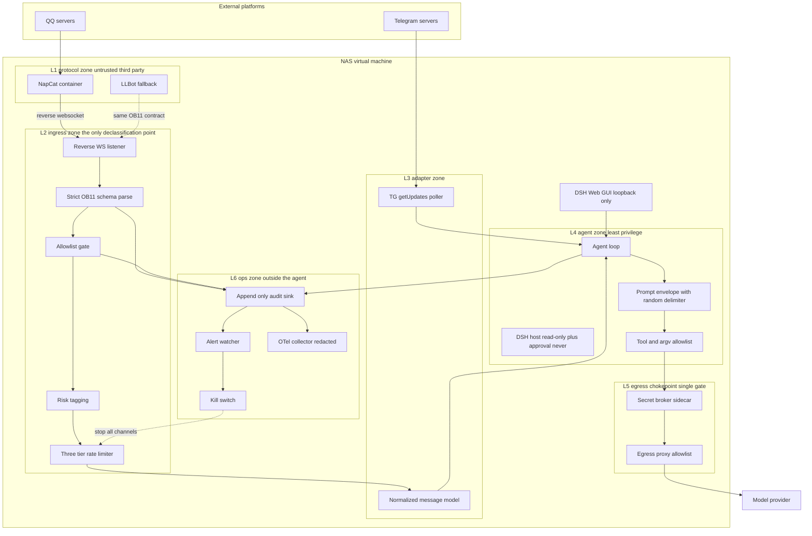

# t2 · 防御架构图与部署参考（Defense Architecture）

> DSH 大肥鱼机器伴侣 · NAS 虚拟机
> 配套：`t2-threat-model.md`（威胁与理由）、`t2-security-baseline.md`（可验证清单）
> 本文给"长什么样 + 怎么落"：分层职责、Mermaid 架构图、compose/profile 参考片段、数据流时序。

---

## 1. 设计公理（先说清为什么是这个形状）

三条从证据推出的公理，决定了整个架构：

1. **DSH 的 sandbox 不是安全边界，只是文件围栏。**
   `@deepseek-ai/dsh-sandbox`：「File effects are the whole policy vocabulary — the seam expresses no network, process, syscall, device, or credential restrictions」；`dsh-fs-sandbox`：「A policy fence, not a kernel boundary … Kernel-grade isolation of untrusted code stays ctx.shell's」。
   → **推论**：网络隔离、进程隔离、凭据隔离必须在**容器/VM/proxy 层**完成。DSH 侧的 `read-only` + `approval: never` 是第二层，不是第一层。
2. **同 OS 用户下没有秘密可言。**
   `dsh-credentials-local`：「agent tool processes run as that same user, so this store cannot isolate secrets from the agent」「That is discretion, not a boundary」。
   → **推论**：LLM key 必须搬出 DSH 进程可读范围（sidecar proxy），否则注入即密钥泄露。
3. **QQ 协议端是不可审计的第三方注入代码。**
   t1 §4.1：容器内装官方 `linuxqq_*.deb` 并改写 `package.json` 的 `main` 指向 `loadNapCat.js`。
   → **推论**：它必须与持密的 DSH 分容器/分 uid/分网络；它的任何端口都不得对 LAN 开放。

由此得到分层原则：**授权在 LLM 之前、能力做减法、出站有唯一闸口、检测与止损不在被保护对象内部。**

---

## 2. 分层职责图



### 各层"必须做什么 / 明确不做什么"

| 层 | 必须做 | 明确不做 |
|---|---|---|
| **L1 协议区** | 只跑 QQ/TG 协议；仅绑 loopback；`cap_drop ALL`；rootfs 只读；plugins 卷受基线哈希监控 | 不放任何 DSH 密钥；不给 docker.sock；不对 LAN 开 WebUI |
| **L2 接入区（唯一下沉点）** | 校验 `access_token` 指纹 + `self_id`；严格 schema（拒绝未知字段，注意 NapCat 请求侧用 JSON5）；**授权判决**；限流；风险打标 | **不把未过闸的消息交给 agent**；不以显示名判身份 |
| **L3 适配区** | OB11 segment ↔ TG entity 双向归一；健康检查走 `heartbeat`+`get_status` | 不使用 napcat 私有扩展 API（既为可移植性，也为攻击面收敛） |
| **L4 agent 区** | `mode: read-only` + `approval: never`；工具/argv 白名单；随机定界符封装外部内容与工具结果；回帖脱敏 | 不持有明文密钥；不直连外网；不自审自停 |
| **L5 出站闸口** | 域名/IP allowlist；阻断 RFC1918 与 metadata IP；secret broker 注入 Authorization | 不允许 agent 绕过 proxy 直连 |
| **L6 运维区** | 独立 watcher 发告警；`!halt` kill switch；append-only + 异地副本；otel 出口先配 redaction | 不经 LLM 决策；不受 agent 生命周期影响 |

---

## 3. 关键流程时序

### 3.1 一条外部消息的安全路径（含拒绝分支）

```
QQ 群成员发消息
  → NapCat(仅 loopback) --反向WS--> DSH listener
  → [握手] access_token 指纹 + self_id 匹配？  否 → 断开 + 告警(TM-007) + 记审计
  → [解析] 严格 OB11 schema，未知字段丢弃；segment 白名单类型过滤(TM-006)
  → [授权] (channel, chat_id, user_id) ∈ 白名单？ 否 → 固定文案回复，不进 agent(TM-001)
  → [身份] 管理意图？→ 需 TG 私聊确认(TM-002)
  → [限流] per-sender/per-chat/global token bucket(TM-012)  超 → 冷却 + 计数
  → [打标] 启发式规则命中 → risk_tags（不静默丢弃）
  → normalize → agent prompt（随机定界符包裹，声明不可信）
  → agent 决定调用工具
  → [工具闸] argv 白名单？sandbox=read-only？approval=never？ 否 → 失败 + 审计(TM-003)
  → [出站闸] 经 secret broker + egress allowlist(TM-004/005)
  → 回帖前脱敏(TM-011)
  → 全程写 8 类审计事件 → watcher 判定是否熔断(TM-014)
```

### 3.2 密钥使用路径（agent 永远看不到明文）

```
agent 需要调 LLM
  → 请求 http://broker:8080/v1/chat/completions  （无 Authorization 头）
  → broker 按 opaque ref 查真实 key，注入 Authorization
  → broker → egress proxy → provider
  → 返回给 agent 的只有响应体
```
失败模式：若有人把 key 放回 launch env / `.env`，`dsh-credentials-local` 的回落链会让它重新可见 → 基线 **D2** 专门验证这一点。

### 3.3 熔断与止损

```
watcher 连续观测到: 凭据路径访问尝试 OR 非白名单出站点 OR N 次审批拒绝
  → 置 degraded 状态（gateway 层，不经 LLM）
  → 所有通道只回固定文案 + owner TG 私聊告警
  → 人工排查后由 owner 解除
owner 主动: TG 私聊 !halt → 立即同上（无需触发条件）
```

---

## 4. compose 参考片段（可直接改用于群晖/NAS）

```yaml
networks:
  net-protocol: { internal: true }
  net-ingress:  { internal: true }
  net-agent:    { internal: true }
  net-ops:      { internal: true }

services:
  napcat:
    image: mlikiowa/napcat-docker:<FIXED-TAG>@sha256:<DIGEST>   # G1: 禁用 latest
    restart: unless-stopped
    read_only: true
    tmpfs: [/tmp]
    cap_drop: [ALL]
    security_opt: ["no-new-privileges:true", "seccomp=./seccomp-napcat.json"]
    networks: [net-protocol]                    # C2: 该网络 internal，无法直连外网/LAN
    ports:
      - "127.0.0.1:6099:6099"                   # C1/C3: 前缀必须有，WebUI 不出本机
    environment:
      MODE: reverse_ws                          # 反向 WS：NAS 不外开监听（t1 §6.2）
      ONEBOT_URL: ws://ingress:3001/onebotv11ws
      WEBUI_TOKEN: ${NAPCAT_WEBUI_TOKEN}        # D4: ≥32B 随机
    volumes:
      - ./data/qq:/app/.config/QQ               # B4: 尽量 :ro（登录态需写则单独收紧 ACL）
      - ./data/plugins:/app/napcat/plugins:ro   # TM-010: 插件目录只读 + 基线哈希监控

  ingress:                                      # L2 唯一下沉点，DSH 自有代码
    build: ./apps/gateway
    read_only: true
    cap_drop: [ALL]
    security_opt: ["no-new-privileges:true"]
    networks: [net-protocol, net-ingress]       # 桥接两侧，充当转发闸口
    ports:
      - "127.0.0.1:3001:3001"                   # 仅本机可达；握手校验 token+self_id（C4）
    environment:
      OB11_EXPECTED_SELF_ID: ${SELF_ID}
      OB11_ACCESS_TOKEN_FINGERPRINT: ${TOKEN_FP}
      RATE_SENDER_PER_MIN: "10"                 # E1
      RATE_CHAT_PER_MIN: "30"
      RATE_GLOBAL_PER_MIN: "60"

  dsh:                                          # L4 agent 区，不含任何明文密钥
    image: <your-dsh-image>@sha256:<DIGEST>
    user: "10001:10001"                         # B5: 与协议端不同 uid
    read_only: true
    tmpfs: [/tmp]
    cap_drop: [ALL]
    security_opt: ["no-new-privileges:true"]
    networks: [net-ingress, net-agent]
    ports:
      - "127.0.0.1:3080:3080"                   # DSH GUI；注意别与 LLBot 默认 3080 撞车（t1 §4.2）
    environment:
      HTTP_PROXY: http://proxy:3128             # C5: 出站唯一闸口
      HTTPS_PROXY: http://proxy:3128
      NO_PROXY: broker,ingress
      # D2: 这里绝不出现 provider key —— 避免 .env 回落链泄露
    volumes:
      - ./data/dsh-home:/home/bot/.dsh
      - ./workspace:/workspace                  # workspaceRoot，agent 侧只读

  broker:                                       # L5 secret broker（TM-004 的核心补偿）
    build: ./apps/secret-broker
    networks: [net-agent, net-ops]
    read_only: true
    cap_drop: [ALL]
    volumes:
      - ./secrets/llm-key:/run/secrets/llm-key:ro   # 只有 broker 能读

  proxy:                                        # L5 egress allowlist
    image: <egress-proxy>@sha256:<DIGEST>
    networks: [net-ops]
    volumes:
      - ./deploy/egress-proxy/rules.conf:/etc/proxy/rules.conf:ro

  tgworker:                                     # L3 TG adapter：getUpdates 长轮询，不开 webhook（C6）
    build: ./apps/tg-adapter
    networks: [net-agent]
    environment:
      TG_BOT_TOKEN: ${TG_BOT_TOKEN}             # 该容器不持其他秘密，可 /revoke（D6）
      HTTP_MODE: polling

  watcher:                                      # L6 检测与告警，独立于 agent
    build: ./ops/watcher
    networks: [net-ops]
    volumes:
      - ./logs:/var/log/dshbot:ro               # 只读消费日志
      - ./state/degraded:/state                 # 熔断标志位，供 ingress 读取
```

---

## 5. DSH profile 参考片段（plugin 组成层，不改源码即可达成）

```yaml
# profiles/bot.readonly.yml —— 机器人会话专用组成（B1）
- name: '@deepseek-ai/dsh-sandbox-policy'
  config:
    mode: read-only                 # fail-safe default；写类动作必然失败
    workspaceRoot: /workspace

- name: '@deepseek-ai/dsh-sandbox'
- name: '@deepseek-ai/dsh-sandbox-local'
- name: '@deepseek-ai/dsh-bash-sandbox'      # 用受限执行器替换 dsh-bash-local
- name: '@deepseek-ai/dsh-fs-sandbox'        # 用围栏后端替换 fs-local（写受限；读仍宽）

- name: '@deepseek-ai/dsh-permission-presets'
  config:
    presets:
      readonly-noask:
        sandbox: read-only
        approval: never            # 无人值守：拒绝而非挂起等待
    defaultPreset: readonly-noask  # 不提供 danger-full-access 预设

- name: '@deepseek-ai/dsh-user-approval'
  config:
    policy: never                  # fail closed：answerer 缺失也不放行

- name: '@deepseek-ai/dsh-host-webserver'
  config:
    host: 127.0.0.1                # unspecified 地址会被该包直接拒绝加载
    port: 3080
    tls: null                      # 仅 SSH 隧道时留空；LAN 场景必须配证书（C7）

- name: '@deepseek-ai/dsh-client-connection'
  config:
    cookieMaxAgeDays: 7            # C8：缩短 owner 会话寿命（该键在包文档中出现）
```

> **注**：以上 YAML 是**形状示意**。`sandbox-policy` / `permission-presets` / `user-approval` / `host-webserver` 的字段均取自各自 README 的 Minimal configuration 示例；`client-connection.cookieMaxAgeDays` 仅在正文出现、未在其配置示例中列出，落地前请用 `dsh dump-config-schema` 复核。

```yaml
# ⚠ otel 外送不是 YAML 配置项：dsh-otel 无 deployment defaults，
#    需由消费者在代码里调 ctx.otel.createEventReporter(options) / createSessionLogReporter(options)
#    （options 显式给 endpoint/scope/resource attrs/queue/diagnostic callback；headers 也必须显式，
#     服务不会自动加 authorization header）。见 F4：先定义 redaction 再启用。
```

**运维提示（来自包文档的行为细节，容易踩）**
- **`dsh-otel` 没有配置表**：「the service has no deployment defaults or automatic collection policy of its own」，挂载本身不发任何数据；审计外送是**写代码**（调用 factory），不是在 profile 里填 endpoint。上面的 profile 片段因此故意不包含 otel 配置——别指望改 YAML 就能出日志。
- `dsh-fs-sandbox` 的读侧**不受限**（「preserving the local filesystem's read behavior」）→ 防 TM-004 只能靠 broker 化 + 出站闸口，不能指望 fs 围栏。
- `dsh-bash-sandbox` 的 denial 由 stderr 推断，可能误报/漏报 → 判决逻辑用白名单前置，denial 只作辅助信号（F6）。
- Windows ACL rung 与旧 Landlock ABI 会报告 `enforcement: 'partial'` → 要求绝对边界时应 reject；NAS 上请确认内核版本支持 Landlock。
- `danger-full-access` 完全不咨询 provider → 机器人 profile 里这个模式必须不可达（上面 presets 表已不含它）。
- NapCat 不支持 `meta_event.lifecycle.enable/disable` → 就绪判定用 `heartbeat` + `get_status`（E6）。

---

## 6. 备选形态与取舍

| 形态 | 描述 | 安全性 | 运维成本 | 建议 |
|---|---|---|---|---|
| **S1 全单容器**（NapCat + DSH + agent 同容器） | 最省事 | ✗ 违背公理 1/2/3：注入即全盘、密钥同用户、协议端与 DSH 无隔离 | 低 | **禁止** |
| **S2 本文推荐：多容器 + 四 internal 网络 + broker/proxy** | 上述 compose | ✓ 满足全部 P0 基线；隔离层次清晰 | 中 | ✅ 首选 |
| **S3 双 VM 分离**（VM-A 只跑协议端，VM-B 跑 DSH+密钥） | QQ 侧彻底与密钥不同机 | ✓✓ 对 TM-009/010 额外一层内核边界 | 中高（NAS 两份资源、内存 ≥4GB×2） | 若 NAS 资源允许（t1 §4.3：NapCat 镜像 GB 级、常驻内存高）则升级到此形态 |
| **S4 协议端换 LLBot 无头** | 轻量 alpine + Node，OB11 接口一致 | ≈ 与 S2 同级；但运行时从 GitHub Release 拉 zip → 供应链风险更高（G3） | 低 | 作为 NapCat 被封/失修时的**平移目标**，切换前补 digest 锁定 |

---

## 7. 落地顺序（给 t3 的执行序）

1. **第 0 步（不写代码也能做的）**：先把网络/compose/端口纪律与凭据 broker 搭起来——这是 P0 里收益最大、成本最低的部分（C1–C5、D1–D3）。
2. **第 1 步**：实现 L2 ingress gateway（反向 WS + 严格 schema + 授权门 + 三级限流）。它是唯一下沉点，先于任何 agent 接线。
3. **第 2 步**：DSH 侧接 normalized model + prompt 定界符 + 工具 argv 白名单（L4）。
4. **第 3 步**：L6 watcher/kill switch/审计 sink（可与第 2 步并行，因为独立于 agent）。
5. **第 4 步**：LLBot 无头模式演练一次，验证"协议端可替换"假设（同时验证 L2 的 schema 严格性真的没绑定单一实现）。
6. **贯穿**：每完成一步就跑 `t2-security-baseline.md` 的对应验证命令，而不是最后统一测。

**验收口径**：以 baseline 的 Go/No-Go 门禁为准；任一 P0 未过即视为未完成，不接受"先上线再补"。
